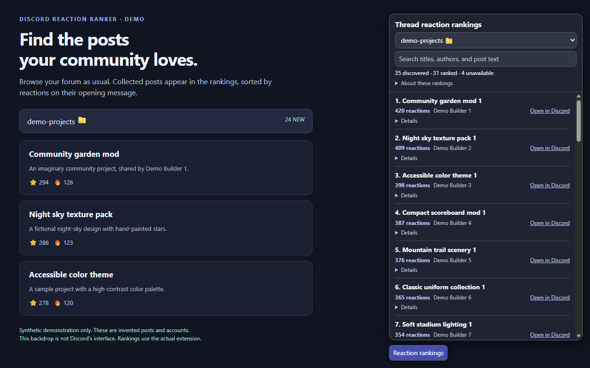
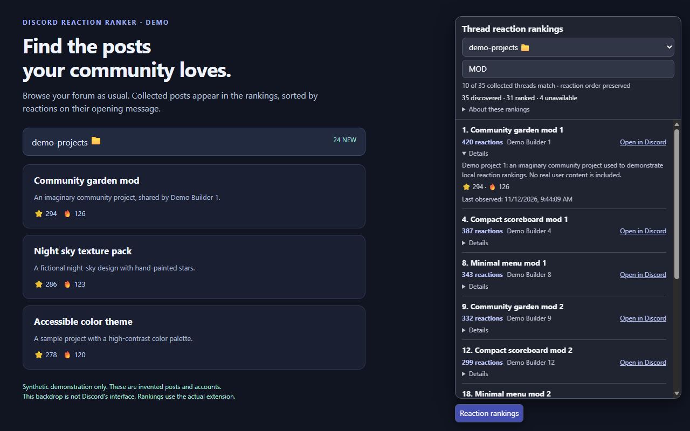

# Discord Reaction Ranker

Find popular Discord forum posts by reactions on their opening messages. An unofficial, local-only extension for desktop **Microsoft Edge and Google Chrome**.

> **AI development disclosure:** This extension was created and coded using OpenAI Codex, an AI coding agent, from the maintainer’s requirements. Its initial implementation was AI-generated.



## Install

Install directly through your browser's extensions page using **Developer mode → Load unpacked**. No browser-store account or submission is involved. See [installation instructions](INSTALL.md).

1. Download the versioned extension ZIP from the project's GitHub Release, when available, and extract it into a permanent folder. Alternatively, download the source and choose the project folder containing `manifest.json`.
2. Open `edge://extensions` in Edge or `chrome://extensions` in Chrome.
3. Enable **Developer mode**, select **Load unpacked**, and choose the extracted folder containing `manifest.json`.
4. Reload open Discord browser tabs. Browse a forum at `https://discord.com`, then select **Reaction rankings** at the bottom right.

No build, bot, credentials, or server administrator access is needed. This does not work in the Discord desktop application. Keep the extracted folder: moving/deleting it breaks an unpacked installation.

To update, replace the unpacked files, click **Reload** on the extension card, and reload Discord. Unpacked installations do not update automatically.

## Features

- Sorts collected posts by total opening-message reactions, including super reactions. Counts represent reactions, not unique people; replies are excluded.
- Searches collected titles, author names, and post previews while preserving reaction order and original rank numbers.
- Uses sidebar forum names, including emoji. Hover options for IDs when names are duplicated. **Unknown forum** means its name has not been observed yet.
- Uses nearly the full window height. Expand **Details** for previews, emoji breakdowns, timestamps, and full titles. Expanded rows stay open during updates and searches.
- Keeps rankings in the current page's memory. **Refreshing starts a fresh collection**; tabs are independent. Switching forums within a page preserves its collections. Only forum names and their server/forum IDs are saved locally.



Screenshots use the real extension over a labeled synthetic demo backdrop, not Discord's interface. All accounts, servers, and posts shown are invented.

## Understanding the counts

| Label | Meaning |
| --- | --- |
| Discovered | Thread IDs observed in this page session |
| Ranked | Threads with an observed opening message |
| Unavailable | Opening message not observed; does not imply zero reactions or deletion |
| Last observed | When those counts were seen, rather than a live counter |

Browse/scroll to collect more posts. The extension observes responses Discord already requests; it does not fetch extra pages or scroll for you. Search covers collected data only. A search's reported total may reflect filters and is not proof of complete coverage. Discord's own cache may prevent new responses even when a post is visible.

## Privacy and permissions

All processing stays on your device. No analytics, advertisements, remote code, or external data transmission. The extension never reads authorization headers or stores tokens. Its only API permission is `storage`; content scripts run only on `https://discord.com/*`.

Post text, author display names, previews, IDs, reactions, and observation times remain in page memory until refresh/close. Only forum names and server/forum IDs are retained in extension-local storage. See the [privacy policy](PRIVACY.md) for details and deletion instructions.

## Limitations and troubleshooting

This project is **not affiliated with or endorsed by Discord, Microsoft, Google, or OpenAI**. Discord response-format/sidebar changes may break collection. Complete or continuously current counts are not guaranteed. Validated page messages cannot be authenticated against other scripts in that page.

If collection is empty, reload the extension and Discord tab, then browse a forum. Ensure extension site access to Discord is enabled. Cached data or unsupported response shapes may not be captured. Report problems using synthetic examples; never upload tokens, HAR files, or private-server captures.

## Development

Requirements: **Node.js 22.15+**, **Python 3.10+** for packaging/icons, and a current desktop browser for integration tests. There are no npm dependencies and no runtime build step. From this repository's root:

```sh
npm ci
npm run check
npm test
npm run test:browser
npm run package
```

The browser test discovers Edge automatically. Set `BROWSER_PATH` to another executable, such as Chrome. Tests create a disposable profile and fulfill fixture traffic locally; they never use your signed-in profile or contact Discord for fixture data.

```powershell
$env:BROWSER_PATH = 'path\to\chrome.exe'
npm run test:browser
```

If a restricted development container prevents the renderer starting, opt into `BROWSER_NO_SANDBOX=1` **for that disposable test process only**. Normal extension use never changes sandbox settings. See [contribution instructions](CONTRIBUTING.md) for browser modes, architecture, and screenshots.

Packaging produces `dist/discord-reaction-ranker-1.1.0.zip` and a SHA-256 checksum using an explicit allowlist, including `INSTALL.md`. After this project is pushed to GitHub, pushing a matching version tag such as `v1.1.0` automatically publishes a GitHub Release with these files after all checks pass. See [release instructions](docs/RELEASING.md).

## License

[MIT](LICENSE). Copyright © 2026 Discord Reaction Ranker contributors. Original icons and synthetic demo assets use the same license. AI-generated provenance does not imply a comprehensive human audit.
